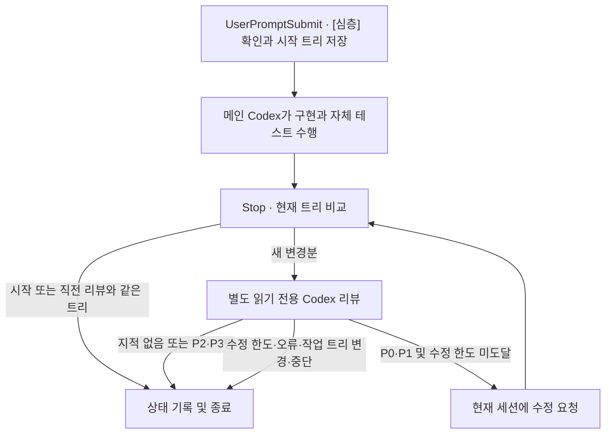

# 외부 독립 리뷰 프로세스 자동화 보고서

벤치마크 실행 2026년 11월 19일 · 프로젝트 소스와 사용자 설치본 대조 2026년 11월 23일

구현 턴의 결과를 별도 읽기 전용 Codex 리뷰 프로세스에 넘긴다. 리뷰는 Git으로 고정한 변경분을 읽고, 기존 구현 세션이 원래 작업 범위 안에서 지적을 재현하고 수정한다. 수정으로 패치가 달라졌을 때만 다음 리뷰로 넘어간다. 실사용에서는 요청 앞에 `[심층]`을 붙여 이 절차를 선택한다. 다른 모델로 구현을 위임한 실험은 내부 오케스트레이션 보고서에 기록했다. 이 문서에 남긴 해당 보고서와 벤치마크 자료의 상대 경로는 당시 참조 위치이며, 현재 사본의 위치에서는 열리지 않는다. [내부 오케스트레이션 실험 보고서](./codex-harbor-benchmark-followup-report-20261119.md)

## 1. 사용한 방법

공식 채점이나 구현 세션의 자체 테스트에서 놓친 회귀를 별도 리뷰가 찾는지 확인했다. 먼저 C++과 xarray의 제출 패치 네 개를 고정해 독립 Sol 리뷰에 넘겼다. 지적은 원본과 수정본에 같은 입력을 넣어 확인했고, 수정을 적용한 뒤에는 공식 검증과 별도 재현을 다시 실행했다.

설계 출발점은 당시 `additional reference.md`에 적은 Hook 제안이었다. 프롬프트에 검수를 지시하는 방식, 구현 단계에 검수 하위 에이전트를 두는 방식, 턴이 끝날 때 Hook으로 별도 검수를 호출하는 방식을 비교한 뒤, 기존 구현 흐름을 바꾸는 범위를 줄이기 위해 종료 시점에 연결했다.

| 방식 | 언제 실행하고 누가 수정하는가 | 실제 적용 |
|---|---|---|
| 독립 리뷰 1회와 수동 복구 | 구현 완료 스냅샷을 별도 리뷰에 넘긴다. 조사한 지적과 공식 실패를 별도의 복구 세션에 필요한 만큼 전달한다. | C++과 xarray의 최초 제출 패치 비교에 사용했다. |
| CLI 래퍼 | `review_gate.py`가 CLI 구현 세션을 시작하거나 기존 세션을 지정받는다. 리뷰 뒤 수정할 때 `codex exec resume`으로 그 세션을 재개한다. | xarray 복구 패치에서 자동 리뷰·재검수 루프를 실험했다. 현재 래퍼의 우선순위 정책은 3절에 기록한다. |
| Codex Stop Hook | `UserPromptSubmit`에서 작업 전 트리를 기록하고 `Stop`에서 변경분을 검수한다. 수정이 필요하면 Hook 응답이 기존 턴에 수정 프롬프트를 전달하고, 다음 종료 시점에 다시 확인한다. `Interrupt`는 검수 상태를 중단으로 기록한다. | 사용자 공통 설정에 설치했다. 로컬 CLI에서 초기 종단간 동작을 확인했고, 현재 정책의 분기는 별도 모의 실행으로 점검했다. |

`experiment` 구성에서 지정한 검수 하위 에이전트는 구현 흐름의 역할 설정에 속한다. 이 문서의 독립 리뷰는 저장한 패치를 구현 종료 뒤 다른 Codex CLI 프로세스에서 읽는 방식이다. 두 경우의 비용과 효과는 각각 해당 실험에 귀속한다.

## 2. 프로젝트 파일과 설치 구조

`review-process/`의 Python 스크립트 세 개는 사용자 설치본과 바이트 단위로 일치한다. `hooks.json`은 설치 스크립트가 Codex 홈에 생성하거나 갱신한다. Hook 실행 기록은 해당 홈의 `deep-review-runs/`에 남는다.

| 파일 | 담당하는 일 |
|---|---|
| `README.md` | 설치 요구 사항, Hook 승인, `[심층]` 사용법, 실행 기록과 로컬 테스트 명령을 안내한다. |
| `install.sh` | Python 스크립트 세 개를 Codex 홈에 복사하고, `hooks.json`에 세 이벤트를 등록한다. |
| `deep_review_hook.py` | `[심층]` 적용 여부, 턴 상태, 재검수, 사용자 알림을 처리한다. 리뷰 실행과 지적 파싱은 `review_gate.py`에 맡긴다. |
| `review_gate.py` | Git 변경분을 고정하고 별도 리뷰를 실행한다. 지적을 검증하고 수정 요청을 만든다. 직접 실행할 때는 구현 세션을 시작하거나 재개하는 CLI 래퍼로 동작한다. |
| `review_usage.py` | CLI 부모 이벤트와 실제 리뷰 자식 세션 로그를 연결한다. 별도 명령으로 실행하면 모델, 토큰, 추정 비용을 기록한다. |
| `test_review_process.py` | 임시 Codex 홈과 Git 저장소, 모의 Codex CLI를 사용해 설치와 Hook 동작을 검증한다. |

[README.md](/Users/song/Desktop/AI-Orchestration/review-process/README.md) · [install.sh](/Users/song/Desktop/AI-Orchestration/review-process/install.sh) · [deep_review_hook.py](/Users/song/Desktop/AI-Orchestration/review-process/deep_review_hook.py) · [review_gate.py](/Users/song/Desktop/AI-Orchestration/review-process/review_gate.py) · [review_usage.py](/Users/song/Desktop/AI-Orchestration/review-process/review_usage.py) · [test_review_process.py](/Users/song/Desktop/AI-Orchestration/review-process/test_review_process.py)

### 2.1 install.sh와 hooks.json

`install.sh`는 `PATH`에서 `python3`와 `codex`를 찾고 `git`이 있는지 확인한다. `codex exec -s read-only review --disable hooks --json --help`가 성공하면 `CODEX_HOME` 또는 기본 경로 `$HOME/.codex`의 `hooks/deep-review/`에 Python 스크립트 세 개를 설치한다. 기존 `hooks.json`의 구조를 먼저 검사하고, 다른 Hook은 보존하면서 이전 심층 검수 등록을 갱신한다. 기존 설정이 바뀌면 직전 내용을 `hooks.json.bak`에 저장한다. [설치 로직](/Users/song/Desktop/AI-Orchestration/review-process/install.sh:47)

`hooks.json`은 `UserPromptSubmit`, `Stop`, `Interrupt`를 각각 25초, 575초, 3초 제한으로 등록한다. 확인한 사용자 설정에는 다음 절대 경로가 등록되어 있다.

```text
/usr/bin/python3 -B /Users/song/.codex/hooks/deep-review/deep_review_hook.py /opt/homebrew/bin/codex /Users/song/.codex
```

`-B`는 Python 바이트코드 캐시 생성을 막는다. 스크립트 뒤 첫 인자는 리뷰에 사용할 Codex 실행 파일이고, 두 번째 인자는 Codex 홈이다. Hook은 이벤트 JSON을 표준 입력에서 읽고 Codex 홈에서 세션 로그를 조회하거나 턴 상태를 저장한다. [사용자 Hook 설정](/Users/song/.codex/hooks.json)

### 2.2 deep_review_hook.py

| 코드 | 의미와 처리 순서 |
|---|---|
| `main()`, `run()` | 표준 입력에서 이벤트 JSON을 읽는다. 출력할 알림이나 수정 요청이 있을 때만 JSON을 반환한다. 파일 생성 시에는 `umask(0o077)`을 사용한다. |
| `UserPromptSubmit`, `start_review()` | 요청 앞의 공백·탭을 제거한 뒤 `[심층]`으로 시작하는 일반 사용자 턴을 고른다. 태그를 제외한 본문을 원래 과제로 저장한다. 계획 모드 또는 Git 작업 트리 밖에서는 검수를 건너뛴다. |
| `state_directory()` | `session_id`와 `turn_id`를 함께 해시해 저장 폴더를 고른다. 같은 세션의 여러 턴을 별도로 관리한다. |
| `lock_state()`, `save_state()` | `status.lock`의 배타 잠금을 걸어 같은 턴의 상태 읽기·갱신을 조정한다. `pending.json`에 먼저 쓴 뒤 `status.json`으로 바꿔 중간에 잘린 JSON을 읽을 가능성을 줄인다. |
| `Stop`, `stop_review()` | 대기 상태를 `reviewing`으로 바꾼 뒤 작업 전 트리와 현재 트리를 비교한다. 변화가 있으면 독립 리뷰를 한 회 실행하고, 리뷰 도중 원래 작업 트리가 바뀌었는지 다시 확인한다. |
| `Interrupt` | 대기 중이거나 검수 중인 턴을 `interrupted`로 기록한다. 진행 중이던 리뷰가 이후 결과를 돌려줘도 이미 중단된 상태를 덮어쓰거나 수정을 요청하지 않는다. |
| `findings_report()`, `notice()` | 지적을 우선순위순으로 보여준다. 최대 여섯 건의 경로, 줄 번호, 요약, 전체 `findings.json` 경로를 알림에 싣는다. |

초기 상태에는 원래 작업 트리 경로 `root`, 태그를 뗀 작업 설명 `task`, 시작 트리 `base`, 완료한 검수 횟수 `reviews`, 진행 상태 `result`가 들어간다. 리뷰를 마치고 원래 작업 트리가 그대로임을 확인하면 `reviews`를 갱신하고 `last_reviewed`를 기록한다. 종료할 때 `status.json`에서 `task`를 제거한다. 리뷰에 전달한 원래 요청은 회차별 `prompt.txt`에 남는다. [진입점과 상태 갱신](/Users/song/Desktop/AI-Orchestration/review-process/deep_review_hook.py:22) · [이벤트 처리](/Users/song/Desktop/AI-Orchestration/review-process/deep_review_hook.py:127)

### 2.3 review_gate.py

| 코드 | 의미와 처리 순서 |
|---|---|
| `git()` | 지정한 디렉터리에서 Git 명령을 실행한다. 이 헬퍼를 통해 부르는 Git 명령은 Git Hook과 파일 감시 설정을 끈다. |
| `snapshot()` | 리비전이 주어지면 해당 트리 ID를 읽는다. 작업 트리를 스냅샷으로 저장할 때는 기존 인덱스가 있으면 임시 위치에 복사한다. 임시 인덱스에 변경을 반영하고 트리 ID를 만든다. 기존 스테이징 상태를 보존하면서 추적 파일 변경과 Git이 추가할 수 있는 새 파일을 비교에 넣는다. |
| `review_checkout()` | 실행 기록 아래에 원래 저장소와 같은 Git 객체 형식으로 검수 작업 트리를 만든다. 기존 객체는 `.git/objects/info/alternates`로 읽고, 시작과 현재 상태를 각각 임시 커밋으로 만든다. 검수 작업 트리의 `HEAD^`는 시작 상태, `HEAD`는 현재 제출 상태가 된다. |
| `independent_review()` | 검수 작업 트리에 원래 저장소의 Git 환경 변수가 넘어가지 않게 걸러낸다. 그 디렉터리에서 `codex exec -s read-only review --disable hooks --json`을 실행한다. `approval_policy="never"`를 전달해 리뷰 프로세스의 승인 요청을 비활성화한다. 리뷰에는 원래 요청과 `HEAD^ → HEAD` 변경 범위를 전달한다. |
| `invoke()` | 실행에 사용한 프롬프트, 시작 시각, CLI 이벤트, 표준 오류를 저장한다. 프로세스가 0으로 끝나고 최종 턴 이벤트가 `turn.completed`인지 확인한 뒤 부모 스레드 ID를 돌려준다. |
| `review_result()`, `finding_priority()` | 실제 리뷰 자식 로그의 마지막 `task_complete` 메시지에서 구조화된 지적을 읽는다. 판정, 파일 위치, 줄 범위, 우선순위를 검증한다. 숫자 우선순위가 빠졌을 때는 제목 앞의 `[P0]`~`[P3]`로 보완한다. 둘이 서로 다르거나 유효 등급을 얻을 수 없으면 오류로 처리한다. |
| `repair_prompt()` | 읽기 전용 리뷰의 지적을 상대 경로·줄 번호·제목·설명과 함께 기존 세션에 보낸다. 각 지적을 재현하고 확인된 문제만 원래 요청 범위에서 수정한 뒤 관련 테스트를 실행하도록 지시한다. 기존 변경을 보존하고 `rm` 사용을 금지하라는 지시도 들어간다. CLI 래퍼에 외부 수용 조건을 넘기면 그 조건도 포함한다. |
| `gate()`, `check_worktree()` | CLI 래퍼로 쓸 때 리뷰와 같은 세션 재개를 반복한다. 리뷰에서 P0·P1 지적이 남지 않은 회차에 `--check`가 설정되어 있으면 시작 트리와 검수한 트리 사이의 바이너리 패치를 만들어 검증 명령에 제공한다. 검증 후의 트리를 리뷰한 트리와 대조해 제출 내용이 바뀌었는지 확인한다. 처음부터 변경이 없으면 리뷰와 검증 명령을 모두 건너뛴다. |

독립 리뷰 실행 제한은 회차당 540초다. `CODEX_DEEP_REVIEW_MODEL`을 설정하면 실행 모델과 리뷰 모델을 함께 지정한다. 이 변수가 비어 있으면 설치된 CLI의 유효 설정을 사용하므로, 실험에서 사용한 Sol과 현재 동작의 리뷰 모델을 구분해야 한다. 검수가 끝난 뒤 임시 체크아웃에 변경이 생겼거나 원래 작업 트리가 움직였으면 결과를 수정 요청에 사용하지 않는다. [Git 트리와 임시 커밋](/Users/song/Desktop/AI-Orchestration/review-process/review_gate.py:19) · [리뷰 출력 검증](/Users/song/Desktop/AI-Orchestration/review-process/review_gate.py:69) · [별도 리뷰 실행](/Users/song/Desktop/AI-Orchestration/review-process/review_gate.py:105) · [수정과 최종 검증](/Users/song/Desktop/AI-Orchestration/review-process/review_gate.py:131)

### 2.4 review_usage.py

`read_events()`는 JSONL의 줄을 JSON 객체로 읽는다. `find_reviewer()`는 `events.jsonl`의 `thread.started`에서 부모 스레드 ID를 얻고, Codex 홈의 `sessions/` 아래에서 `rollout-*.jsonl`을 찾는다. 파일 수정 시각이 `started-at.txt` 파일의 수정 시각보다 이른 후보는 제외한다. 후보의 첫 줄이 `session_meta`이고, `source`가 `{"subagent": "review"}`이며 `parent_thread_id`가 일치해야 한다. 찾은 파일이 정확히 하나일 때 그 파일을 리뷰 로그로 사용한다. 최상위 CLI에서 사람이 읽는 결과를 그대로 파싱할 때 생기는 불확실성을 줄이기 위한 조건이다.

`save_usage()`는 별도 명령으로 실행할 수 있다. 리뷰 자식 로그에서 `turn_context`와 `token_count`를 읽고 모델, 추론 강도, 최대 단일 요청 입력, 누적 토큰, 추정 비용을 `usage.json`에 쓴다. 코드의 비용식은 `gpt-6.2-sol`의 최대 단일 요청 입력이 272,000토큰 이하이고 캐시 쓰기 입력 토큰이 없을 때만 적용한다. 그 밖에는 추정 비용을 `null`로 기록한다. Hook과 CLI 래퍼는 리뷰 자식 로그를 복사한다. `usage.json`을 생성하려면 `python3 -B review_usage.py <리뷰 회차 폴더> <Codex 홈의 sessions 폴더>`를 별도로 실행한다. [로그 연결과 비용 집계 구현](/Users/song/Desktop/AI-Orchestration/review-process/review_usage.py:7)

### 2.5 test_review_process.py

여섯 개 테스트가 다른 Hook 보존, 재설치와 잘못된 설정 처리, P0·P1 수정 요청과 P2·P3 동시 보고, 수정 후 변경분이 그대로인 경우와 사용자 중단, 수정·검수 한도, 유효하지 않은 우선순위 처리, 첫 커밋 전 저장소에서 기존 스테이징을 보존하는 동작을 검증한다. 이번 대조에서 `review-process/` 안에서 `python3 -B -m unittest discover -s . -v`를 실행해 여섯 개가 모두 통과했다. 이 테스트는 모의 Codex CLI를 실행한다. [테스트 구현](/Users/song/Desktop/AI-Orchestration/review-process/test_review_process.py:51)

## 3. 턴 종료에서 일어나는 일



현재 Hook과 CLI 래퍼는 확인된 우선순위에 따라 **P0·P1만 자동 수정**에 보낸다. P2·P3은 보고한다. Hook에서 P0·P1 수정 요청과 P2·P3 지적이 한 회차에 함께 나오면 그 회차의 P2·P3을 `systemMessage`로 요약하면서 P0·P1을 기존 세션에 수정 요청으로 보낸다. 그때 Hook 응답의 핵심 필드는 아래와 같다.

```json
{
  "decision": "block",
  "reason": "재현할 P0/P1 지적과 원래 작업의 수정 범위",
  "systemMessage": "함께 발견한 P2/P3 지적과 전체 기록 경로"
}
```

`decision: "block"`은 종료를 보류한다. Codex가 `reason`을 같은 작업의 다음 프롬프트로 전달하며, `systemMessage`는 사용자에게 보여 주는 알림이다. 종료할 때는 상태를 저장하고 알림을 반환한다. [수정 요청과 동시 보고](/Users/song/Desktop/AI-Orchestration/review-process/deep_review_hook.py:89) · [Codex Stop Hook 문서](https://learn.chatgpt.com/docs/hooks#stop)

| 상태 | 확인할 상황 |
|---|---|
| `pending` / `reviewing` | `pending`은 작업 시작 또는 수정 후 다음 검수를 기다리는 상태다. `reviewing`은 Stop 처리가 진행 중인 상태다. |
| `review-clear` / `report-only` | 지적이 없거나, 자동 수정 대상이 없는 P2·P3 지적만 남았다. |
| `no-changes` / `no-progress` | `no-changes`는 처음부터 변경이 없거나 작업 전 트리로 돌아갔을 때 기록한다. `no-progress`는 수정 요청 후에도 직전 리뷰 트리와 같을 때 기록하고 해당 패치는 다시 리뷰하지 않는다. |
| `repair-limit` | 한도까지 리뷰·수정한 뒤에도 P0·P1이 남았다. 마지막 지적과 파일 경로가 알림에 표시된다. |
| `worktree-changed` / `error` / `interrupted` | 리뷰 도중 작업 트리가 바뀌었거나, 실행·파싱 과정에서 오류가 발생했거나, 사용자가 턴을 중단했다. 오류 내용은 가능할 때 `error.txt`에 남는다. |

Hook은 `MAX_REPAIRS = 3`에 따라 **수정 요청을 최대 세 번 보내고 리뷰를 최대 네 번 실행**한다. CLI 래퍼는 같은 기본값을 사용하며 `--max-repairs`로 한도를 지정할 수 있다. 최초 설치 당시 보고서의 한 번 제한은 당시 정책이었다. 현재 소스의 설치와 Hook 분기는 2.5절의 모의 테스트로 확인했다. 이번 대조는 로컬 소스와 설치 설정, 모의 테스트를 대상으로 했다. [수정 횟수 상수](/Users/song/Desktop/AI-Orchestration/review-process/review_gate.py:15) · [종료 상태 구현](/Users/song/Desktop/AI-Orchestration/review-process/deep_review_hook.py:89)

## 4. 실행 기록과 벤치마크 파일

### 4.1 현재 실행에서 볼 파일

| 파일 또는 폴더 | 확인할 내용 |
|---|---|
| `status.json`, `status.lock` | Hook의 `status.json`은 `result`, 작업 전 트리, 마지막 리뷰 트리와 리뷰 횟수를 담는다. `status.lock`은 상태 갱신을 직렬화한다. CLI 래퍼의 `status.json`은 정상 종료 시 `status`와 세션 ID를 담으며, 오류가 나면 `detail`에 오류를 기록한다. |
| `review-N/repository/` | 해당 회차의 시작 커밋과 제출 커밋이 담긴 고정 체크아웃이다. 회차별 변경분은 이 디렉터리에서 `git diff HEAD^ HEAD`로 확인할 수 있다. |
| `prompt.txt`, `started-at.txt` | Codex 호출에 전달한 프롬프트와 시작 시각이다. 리뷰 자식 로그를 찾을 때는 `started-at.txt`의 파일 수정 시각을 사용한다. |
| `events.jsonl`, `stderr.txt` | CLI 부모 프로세스의 이벤트와 오류 출력이다. 리뷰 시작, 실행 실패, 종료 상태를 확인한다. |
| `final.txt`, `reviewer-rollout.jsonl`, `findings.json` | 사람이 읽는 최종 메시지, 실제 자식 리뷰의 원본 로그, 도구가 검증하고 정리한 판정과 지적이다. |
| `repair-N/`, `verification/` | 직접 실행한 CLI 래퍼가 구현 세션을 재개하거나 `--check`를 실행할 때 쓰는 폴더다. 검증의 `candidate.patch`, `output.txt`, `exit-code.txt`에서 제출 내용과 명령 결과를 확인한다. 벤치마크에서 별도로 재채점한 결과는 `test-output.txt`, `reward.txt`, `report.json`으로 남았다. |
| `error.txt`, `usage.json` | Hook의 리뷰 처리 중 잡은 예외와 별도 비용 집계 명령의 결과를 각각 담는다. |

경로, 원래 요청, 실제 리뷰 텍스트가 기록에 남으므로 다른 사람에게 공유할 때는 필요한 부분을 골라 전달한다. Hook과 CLI 래퍼는 현재 경로가 저장소의 하위 폴더여도 Git 작업 트리 루트에서 변경분을 수집한다. 같은 작업 트리에서 다른 턴이나 작업이 동시에 파일을 고치면 해당 턴의 시작 이후에 들어온 변경도 비교에 포함될 수 있다.

### 4.2 벤치마크에서 쓴 도구와 남아 있는 근거

아래 파일명과 링크는 실험 당시에 쓴 도구와 결과의 원래 상대 경로를 기록한 것이다. 첨부 문서가 놓인 위치에서는 이 파일을 확인할 수 없으므로 5절의 수치와 결과는 기존 보고 내용을 따른다.

| 실험 당시 도구 | 역할과 남은 결과 |
|---|---|
| `capture.py` | Harbor에서 작업 시작과 구현 종료에 작업 트리를 저장했다. `base.tar.gz`와 `P0.tar.gz`를 비교해 제출 변경을 고정했다. C++ 검증기가 실행되면서 Git과 테스트 파일을 바꾸므로, 검증 전에 채집한 스냅샷을 사용했다. |
| `prepare_review.py`, `review.sh` | 시작·제출 스냅샷으로 리뷰할 Git 체크아웃과 패치를 준비하고 별도 읽기 전용 리뷰를 호출했다. 실행별 `review/P0.patch`, `review/final.txt`, `review/usage.json` 등으로 입력과 결과를 확인한다. |
| `repro.cpp`, `validate.sh` | C++ 로캘, 부동소수점 상태, 정수 변환을 원본과 패치에 같은 입력으로 재현하고 복구 전후를 확인했다. |
| `probe_xarray.py`, `validate_xarray.sh` | `DataArray`와 `Dataset` 기본 재현을 돌려 변경 전후의 좌표 속성을 비교했다. |
| `probe_xarray_scalar.py` | `x`가 라벨 없는 스칼라일 때 조건 좌표의 속성이 출력에 남는지 확인했다. |
| `probe_xarray_merge.py` | 좌표를 병합할 때 버려진 스칼라 좌표의 속성이 선택된 인덱스 좌표로 넘어가는지 확인했다. |
| `probe_xarray_input_attrs.py` | 결과를 계산한 뒤 입력 객체의 속성이 수정되는지 확인했다. |
| `verify_xarray_candidate.sh` | 고정 패치를 원래 작업 환경에 적용해 공식 검증을 재실행했다. 별도 프로브도 함께 실행해 그 패치에 해당하는 공식 테스트와 추가 검사의 결과를 남겼다. |
| 당시 `review_gate.py`, `acceptance.md` | xarray의 반복 검수에 사용했다. 수용 조건 문서에는 리뷰가 반복해서 바꾸자고 제안한 스칼라 속성 규칙을 적어 복구와 리뷰 양쪽에 전달했다. |

[C++ 시작·제출 스냅샷](../jobs/native-luna-20261119-123947/nlohmann__json-191__M8k4h9q/workspace/) · [C++ 제출 패치](../jobs/native-luna-20261119-123947/nlohmann__json-191__M8k4h9q/review/P0.patch) · [C++ 재현 결과](../jobs/native-luna-20261119-123947/nlohmann__json-191__M8k4h9q/review/reproduction.txt) · [xarray 스칼라·병합 프로브](../jobs/baseline-xarray-20261119-133332/pydata__xarray-7229__ejY8eVw/comparison/) · [xarray 마지막 회차 기록](../jobs/baseline-xarray-20261119-133332/pydata__xarray-7229__ejY8eVw/repair/automatic-review-with-acceptance/review-2/)


## 5. 독립 리뷰와 복구 실험 결과

벤치마크 파일에서 패치 이름 `P0`은 최초 제출본, `P1`은 첫 복구본을 뜻한다. 리뷰 지적에 붙은 P0~P3은 지적의 우선순위를 뜻한다.

### 5.1 C++에서 공식 검증이 놓친 회귀를 찾았다

공식 1.0 패치도 다른 로캘과 수치 경계에서 잘못 동작할 수 있다는 가설을 검증했다. C++ `native-luna` 패치의 독립 Sol 리뷰는 쉼표 소수점 로캘의 `42.0` 왕복 실패, `DBL_MAX` 출력 시 `FE_OVERFLOW`와 `errno` 변화, `__int128` 구성의 정수 저장 문제를 찾았다. Linux에서 세 문제를 재현한 뒤 별도 Sol 복구 세션에 전달했다. P1은 세 재현과 공식 채점 1.0을 유지했고, 저장소 자체 통과 건수는 28개에서 31개로 늘었다. 트랩에 의한 프로세스 종료는 대조군에서도 발생하지 않아 확인 범위를 부동소수점 상태 변화까지로 제한했다. 파일럿의 리뷰는 $0.3153, 복구는 $0.3867이었다. 구현을 포함한 해당 패치의 계측 합계는 $1.3315였다. [C++ 세 회귀 재현](../jobs/native-luna-20261119-123947/nlohmann__json-191__M8k4h9q/review/reproduction.txt) · [트랩 대조](../jobs/native-luna-20261119-123947/nlohmann__json-191__M8k4h9q/review/overflow-control.txt) · [복구 후 검증](../jobs/native-luna-20261119-123947/nlohmann__json-191__M8k4h9q/repair/P1-verification.txt)

C++ 바닐라의 독립 리뷰도 $0.3725를 들여 별도로 진행했다. 양수 `42`만 사용한 재현을 음수 `-1`로 넓히자 두 최초 패치에 공통 문제가 있음을 확인했다. 또한 `float` 설정에서 원본이 `16777217e0`을 `16777217`로 보존한 반면, 두 최초 패치와 복구한 P1은 `16777216`을 반환했다. 이 정밀도 회귀는 최종 관찰에서 미해결로 남았다. 공식 검증을 통과한 뒤에도 리뷰와 재현이 제공하는 정보가 있음을 보여준다. [C++ 바닐라 리뷰](../jobs/baseline-20261119-132137/nlohmann__json-191__CsHzvkZ/review/final.txt) · [추가 수치 재현](../jobs/baseline-20261119-132137/nlohmann__json-191__CsHzvkZ/comparison/additional-probes.txt)

### 5.2 xarray에서 공식 실패와 리뷰 지적을 함께 복구했다

xarray의 두 독립 리뷰는 공식 검증에서 실패한 스칼라 조건을 보고하지 못했다. 대신 좌표 병합에서 값이 버려진 스칼라 좌표의 속성 `hours`가 값이 유지된 인덱스 좌표에 붙는 문제를 찾았다. 재현에서 원본은 `days`를 유지하고, 두 최초 패치는 `hours`를 반환했다. 독립 리뷰 비용은 바닐라 $0.1546, 역할 지정 조건 $0.2917이었다. 두 검증이 잡은 문제가 달랐으므로 공식 실패와 독립 재현을 모두 복구 작업에 넘겼다. [xarray 바닐라 리뷰](../jobs/baseline-xarray-20261119-133332/pydata__xarray-7229__ejY8eVw/review/final.txt) · [역할 지정 조건 리뷰](../jobs/native-luna-xarray-20261119-134014/pydata__xarray-7229__KAt9Ejq/review/final.txt) · [좌표 병합 재현](../jobs/baseline-xarray-20261119-133332/pydata__xarray-7229__ejY8eVw/comparison/merge-probe.txt)

두 차례의 별도 Sol 복구와 직접 보완을 거쳐 바닐라 P0를 수정했다. 검증 중에는 컨테이너 네트워크 차단으로 패키지 설치가 실패했고, 추가 테스트 파일이 공식 테스트 패치와 겹쳤다. 검증기의 네트워크 조건을 기존 환경에 맞추고, 추가 테스트를 별도 파일에 두고, 원래 Git 체크아웃에 패치를 적용해 다시 검사했다. 두 선택값이 스칼라일 때의 경로를 Sol이 고쳤고, `DataArray`가 입력되어 `Dataset`이 반환될 때 변수 속성이 데이터셋 전체로 새는 문제를 직접 좁혀 고쳤다. 이 시점에서 **별도 회귀 7개와 공식 테스트 281개를 통과해 Harbor가 0.0에서 1.0으로 올라갔다.** 최초 구현 $0.2430에 초기 리뷰·별도 Sol 복구 두 번까지 더한 모델 추정 비용은 $0.8082였다. 직접 보완의 모델 비용은 별도로 계측하지 않았다. [복구 패치](../jobs/baseline-xarray-20261119-133332/pydata__xarray-7229__ejY8eVw/repair/P1.patch) · [공식과 별도 검증 결과](../jobs/baseline-xarray-20261119-133332/pydata__xarray-7229__ejY8eVw/repair/P1-verification-complete.txt)

### 5.3 같은 세션의 수정과 재검수를 반복했다

작업 맥락이 남아 있는 구현 세션을 다시 열면 리뷰 지적을 확인하고 필요한 수정만 할 수 있다는 가설로 CLI 래퍼를 적용했다. 최상위 CLI의 `--json` 출력에서 마지막 리뷰 메시지는 사람이 읽는 텍스트였다. 판정은 실제 리뷰 자식 세션의 완료 이벤트에 있는 `findings`와 `overall_correctness`에서 읽었다. 매번 다른 고정 패치로 재리뷰하고, 작업 트리가 바뀌거나 결과를 파싱할 수 없거나 변경이 없으면 상태와 로그를 남겼다. Git 임시 인덱스를 사용해 기존 스테이징을 보존했다. `--acceptance-file`의 수용 조건은 리뷰와 복구 양쪽에 전달했고, `--check`가 있으면 통과한 패치에 지정 검증 명령을 실행하도록 했다.

| 단계 | 무엇을 확인하고 왜 다음 단계로 갔는가 | 결과 |
|---|---|---|
| 첫 자동 실행 | 속성 콜백 범위, `Variable` 속성 누출, 대체 인덱스의 속성, 버려진 지연 좌표 접근을 재현했다. 이후 인덱스가 생길 때 기존 속성이 사라지는 경우도 확인했다. | 리뷰 4회, 동일 세션 수정 3회 뒤 `repair-limit`. 마지막 고정 패치는 신규 테스트 14개와 공식 검증을 통과했다. |
| 수용 조건을 명시한 실행 | 리뷰가 양쪽 값이 스칼라일 때 좌표 속성을 비우라는 공식 요구와 충돌하는 수정을 제안해, 해당 요구를 문서에 고정했다. 그룹화 입력에서 좌표 속성이 사라지는 회귀를 재현하고 수정했다. | 리뷰 2회, 동일 세션 수정 1회 뒤 `repair-limit`. |
| 마지막 패치 재채점 | 마지막 리뷰가 통과하지 않아 자동 `--check` 대신 같은 고정 패치를 외부에서 채점하고 별도 재현을 돌렸다. | 별도 테스트 18개, 공식 테스트 281개 통과·1개 건너뜀, Harbor 1.0. |

최초로 1.0을 얻은 시점은 자동 반복 전에 수행한 복구 단계였다. 자동 루프는 추가 회귀를 찾고 일부를 고쳤으며 **리뷰 6회·수정 4회에 $2.5871**을 추가로 사용했다. 최초 구현부터 마지막 자동 검수까지 계측 합계는 **$3.3952**, 최초 바닐라 구현의 약 14배였다. 이 배수는 점수 0.0의 최초 구현과 초기 복구·반복 검수까지 포함한 전체 경로의 비용 비율이다. 마지막 리뷰에서는 `float64`의 `2**53`과 `int64`의 `2**53 + 1`을 같은 좌표로 취급해 속성이 복사되는 문제를 재현했고, 이 문제는 남았다. 다른 지적 중에는 원본에서도 정렬 오류가 나는 경우와 재현을 완료하지 못한 경우가 있었다. [첫 자동 실행 사용량](../jobs/baseline-xarray-20261119-133332/pydata__xarray-7229__ejY8eVw/repair/automatic-review/usage-summary.json) · [수용 조건](../jobs/baseline-xarray-20261119-133332/pydata__xarray-7229__ejY8eVw/repair/automatic-review/acceptance.md) · [두 번째 자동 실행 사용량](../jobs/baseline-xarray-20261119-133332/pydata__xarray-7229__ejY8eVw/repair/automatic-review-with-acceptance/usage-summary.json) · [최종 상태](../jobs/baseline-xarray-20261119-133332/pydata__xarray-7229__ejY8eVw/repair/automatic-review-with-acceptance/status.json) · [최종 테스트](../jobs/baseline-xarray-20261119-133332/pydata__xarray-7229__ejY8eVw/repair/automatic-review-with-acceptance/review-2/verification/test-output.txt) · [남은 결함 재현](../jobs/baseline-xarray-20261119-133332/pydata__xarray-7229__ejY8eVw/repair/automatic-review-with-acceptance/review-2/remaining-probe-results.txt)

### 5.4 비용과 검증 범위

| 항목 | 횟수 | 모델 추정 비용 |
|---|---:|---:|
| 초기 독립 리뷰 | C++ 두 패치, xarray 두 패치 | $1.1341 |
| 초기 별도 Sol 복구 | C++ 1회, xarray 2회 | $0.7973 |
| xarray 자동 리뷰·복구 | 리뷰 6회, 동일 세션 수정 4회 | $2.5871 |

이 합계의 비용은 리뷰·복구에 사용한 모델의 추정 비용이다. 최초 구현 비용은 내부 오케스트레이션 문서에서 확인한다. 실사용 Hook 최초 설치 때는 임시 Git 저장소에서 일반 요청과 태그를 붙인 요청을 각각 시험했다. 일반 요청에서는 리뷰 기록이 없었고, 태그 요청은 내장 리뷰 한 회 뒤 `review-clear`에 도달했다. 이번 대조에서는 프로젝트와 설치본의 스크립트 일치 여부, Hook 등록과 모의 테스트의 결과를 확인했다. 현재 설치본의 실작업 비용·품질과 데스크톱 동작은 별도 측정 대상이다.

당시 xarray 자동 리뷰의 지적 16건은 P2가 13건, P3가 3건이었다. 현재 P0·P1 수정 정책을 그때의 첫 결과에 적용하면 한 회 뒤 보고하고 종료한다. 공식 검증과 독립 리뷰의 결론이 다른 사례도 있었다. 리뷰는 특정 경계 조건을 찾는 데 도움이 됐으며, 작업 완료 판단에는 과제 공식 검증과 재현 결과도 함께 사용해야 한다. [당시 첫 회차 지적](../jobs/baseline-xarray-20261119-133332/pydata__xarray-7229__ejY8eVw/repair/automatic-review/review-1/findings.json) · [마지막 회차 지적](../jobs/baseline-xarray-20261119-133332/pydata__xarray-7229__ejY8eVw/repair/automatic-review-with-acceptance/review-2/findings.json)

## 6. 사용법과 다른 환경에서 재현하는 방법

설정된 로컬 Codex의 Git 작업 트리에서 요청 맨 앞에 태그를 붙인다. 태그가 없는 턴도 Codex 종료 이벤트는 발생할 수 있으며, 이 Hook은 참가 상태가 없는 턴에서 리뷰를 시작하지 않는다.

```text
[심층] 페이지네이션 오류를 수정하고 관련 테스트를 실행한다.
```

다른 컴퓨터에서는 Bash, Git 2.31 이상, Python 3.8 이상과 로그인된 최신 Codex CLI를 준비한 뒤 저장소에서 설치 스크립트를 실행한다. [설치 요구 사항](/Users/song/Desktop/AI-Orchestration/review-process/README.md:3)

```bash
cd review-process
./install.sh
```

설치가 끝나면 Codex CLI의 `/hooks`에서 `UserPromptSubmit`, `Stop`, `Interrupt`를 확인하고 승인한다. [Hook 승인 방법](https://learn.chatgpt.com/docs/hooks#review-and-trust-hooks)

Hook 이벤트와 별개로, 같은 리뷰 코드를 작업 CLI로 실행할 수 있다. 아래는 테스트 명령까지 넘기는 예시다. `--artifacts`에는 작업 트리 밖의 비어 있는 디렉터리를 지정한다. 생략하면 래퍼가 임시 디렉터리를 만든다. `--check`는 마지막에 두고 그 뒤에 검증 명령과 인자를 전달한다.

```bash
/usr/bin/python3 -B /Users/song/.codex/hooks/deep-review/review_gate.py \
  --cwd /path/to/git-project \
  --task-file /path/to/task.md \
  --artifacts /tmp/codex-review-example \
  --max-repairs 3 \
  --check python3 -m pytest
```

이미 실행한 구현에 붙이려면 `--session`과 작업 전 Git 리비전인 `--base`를 함께 넘긴다. 래퍼는 같은 작업 트리의 기존 스레드인지 확인하고, 수정 뒤에도 같은 세션인지 대조한다. `--acceptance-file`은 합의한 동작을 리뷰와 수정 프롬프트에 넣는 인자다. `--check`는 리뷰를 마친 회차에 P0·P1이 남아 있지 않을 때 실행한다. 검증 명령에는 `CODEX_REVIEW_PATCH`와 `CODEX_REVIEW_ARTIFACTS` 환경 변수를 제공한다. `--benchmark-session`은 구현과 재개에 사용자 설정을 무시하고 `gpt-6.2-sol`과 높은 추론 강도를 지정한다. 독립 리뷰의 모델은 `CODEX_DEEP_REVIEW_MODEL` 또는 CLI 설정에서 결정한다. 래퍼는 `review-clear`, `report-only`, `no-changes`에서 종료 코드 0을 반환한다. 수정 한도, 수정 정체, 수정 후 작업 전 트리로 복귀, 검증 실패, 실행 오류는 각각 `repair-limit`, `no-progress`, `changes-reverted`, `check-failed`, `error`로 기록하고 종료 코드 1을 반환한다. `report-only`이면 전체 P2·P3 지적을 `findings.json`에서 확인한다. [CLI 인자와 실행 결과](/Users/song/Desktop/AI-Orchestration/review-process/review_gate.py:209)
